# SIMULA67

**Turn a 2D floor plan into an editable 3D building on your phone, then walk through it by tracking your phone's movement in real space.**

A personal AR/VR prototype built with AI-assisted development (2026).

<p align="center">
  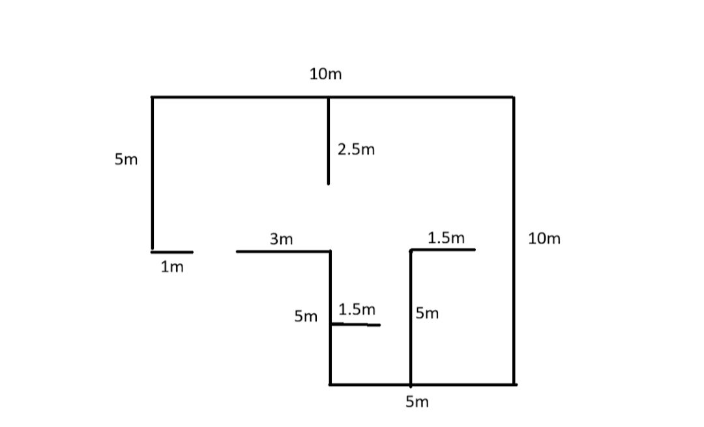
  &nbsp;➜&nbsp;
  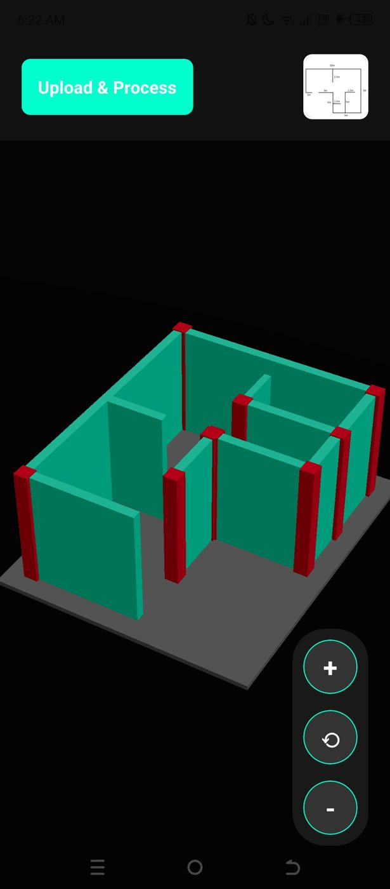
</p>

| Part | Folder | What it does |
|---|---|---|
| 📱 Mobile app | `SIMULA67/mobile-app/` | React Native (Expo) app with a 3D building editor and a camera-based tracking screen |
| 🧠 Server ("Mother Brain") | `SIMULA67/python-server/` | FastAPI + OpenCV. Reads the floor plan image and runs the motion tracker. |

---

## Features

### 1. Floor plan → 3D building
- Upload a floor plan image from your gallery
- The server finds the wall lines (OpenCV edge detection + Hough line transform) and sends them back as coordinates
- The app builds the walls in 3D using real-world sizes (2.5 m rooms, 15 cm walls, 30 cm columns)
- **Columns appear automatically** wherever two or more walls meet
- **Floor slabs** are sized automatically to fit each floor

### 2. 3D editor
- **Doors and windows:** tap a wall and the app cuts an opening at that spot (correct door/window height, sill and lintel)
- **Stairs:** tap the floor to place a 14-step staircase that reaches the next level
- **Multiple floors:** add levels, show/hide each one, switch which floor you're editing
- **Floor styles:** "Exact" (same size as below) or "Terrace" (wider slab)
- **Align floors:** a D-pad nudges an upper floor 0.2 m at a time so it lines up with the one below
- **Undo / Redo** with full history
- **Edit vs Full Render** view modes, plus zoom and camera reset

<p align="center">
  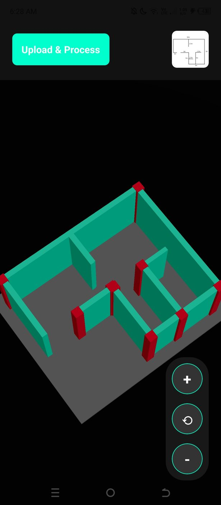
  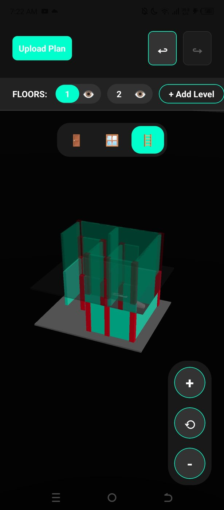
  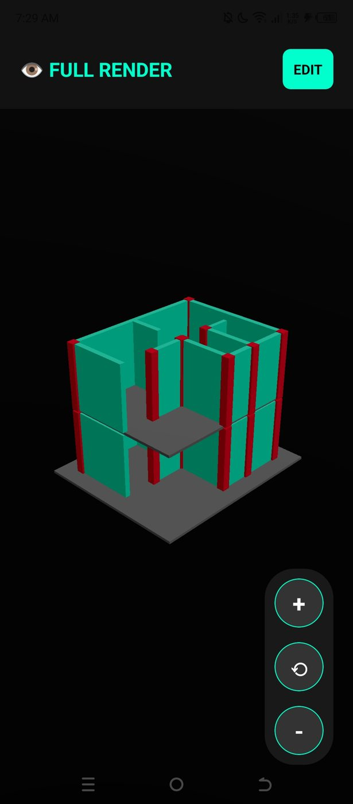
  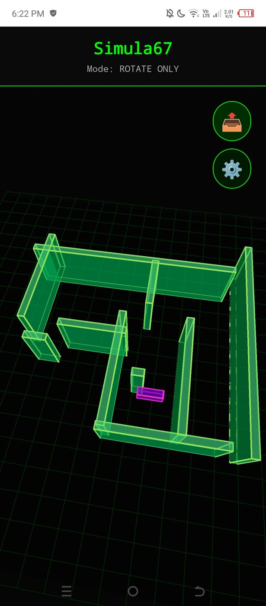
</p>

### 3. Mini-SLAM tracking (phone ↔ PC)
- The phone streams camera frames + gyroscope data to the PC over **WebSockets**
- The PC tracks feature points between frames (**Lucas-Kanade optical flow**)
- **RANSAC filtering** throws away bad points (the "drunk" points) and keeps the reliable ones (the "sober" points)
- **Gyro gating:** when the phone is rotating, movement is paused, so turning isn't mistaken for walking
- **Noise fixes:** a dead zone stops jitter when you stand still, and a speed limit ignores motion-blur jumps
- **X-Ray debugger:** a live PC window draws the tracked points in green and the rejected ones in red

### 4. Calibration and VR mode (later version)
- **Marker calibration:** a webcam on the PC reads ArUco markers to set the real-world scale ("True Scale Feed")
- **Mother Link:** the phone shows its live position (strafe, height, depth) from the PC
- **Tracking lost → Coasting:** if tracking drops, the app keeps estimating instead of freezing
- **Manual fixes:** Sync Alignment, Sync Yaw and Floor Up/Down buttons let the user correct drift
- **VR system menu** floating in the world: purge lines, exposure control, summon, exit VR

<p align="center">
  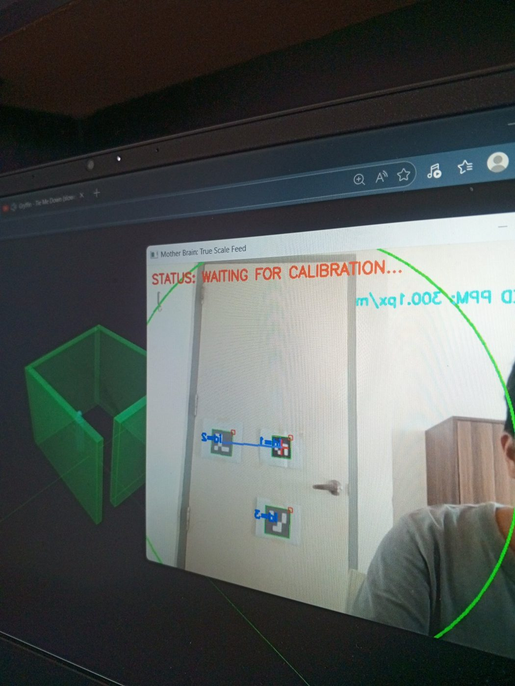
  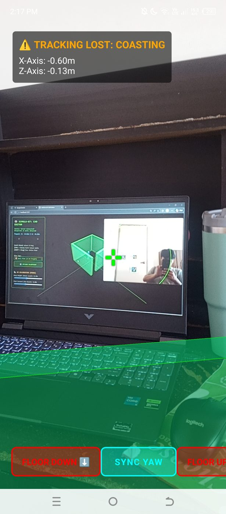
  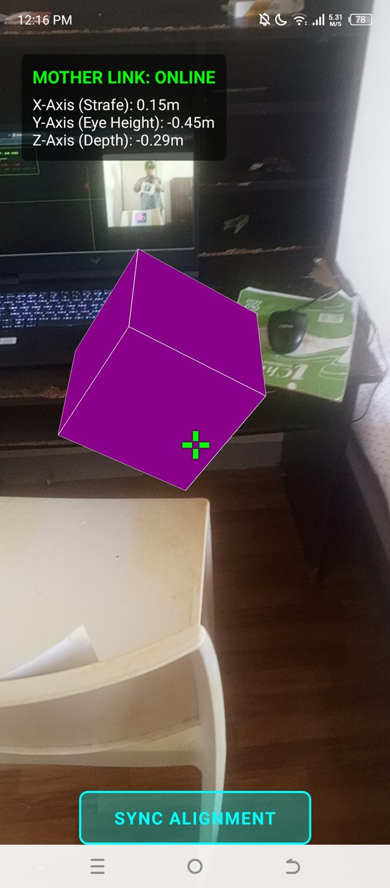
</p>
<p align="center">
  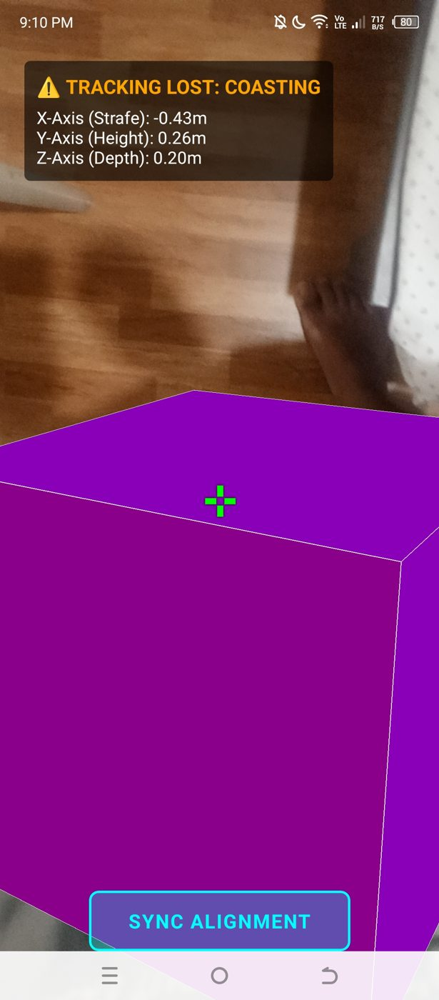
  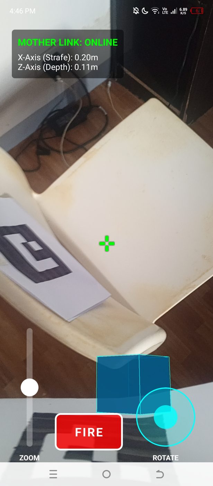
  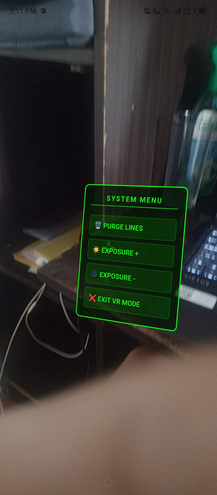
  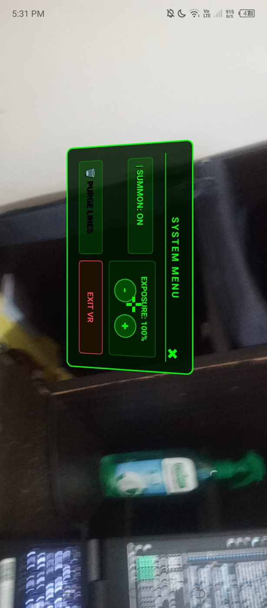
</p>

> Note: this repo holds the code of an earlier build (features 1–3). The calibration and VR features in section 4 come from a later build that is shown in screenshots only.

---

## Tech stack

**Mobile:** React Native 0.81, Expo 54, React Three Fiber + Drei (Three.js), React Navigation, Vision Camera, Expo Sensors (gyroscope), Expo Image Picker

**Server:** Python, FastAPI, WebSockets, OpenCV, NumPy

---

## How it works

```
 Phone (Expo app)                          PC (FastAPI "Mother Brain")
 ────────────────                          ───────────────────────────
 Upload floor plan  ── HTTP POST ──────▶  /process-blueprint/
                                            Canny → HoughLinesP → wall coordinates
 3D editor (R3F)    ◀────── JSON walls ──

 Camera + gyro      ── WebSocket ──────▶  /slam-ws/
                                            Optical flow → RANSAC → dx, dy
 Position HUD       ◀────── JSON dx/dy ──   X-Ray debug window
```

---

## Run it locally

**Server**
```bash
cd SIMULA67/python-server
python -m venv venv
venv\Scripts\activate          # Windows
pip install fastapi uvicorn opencv-python numpy python-multipart
uvicorn main:app --host 0.0.0.0 --port 8000
```

**Mobile app**
```bash
cd SIMULA67/mobile-app
npm install
npx expo run:android            # needs a dev build (Vision Camera)
```
Change the server IP in `App.js` and `SlamScreen.js` to your PC's local IP. The phone and PC must be on the same Wi-Fi.

---

## Known limits / next steps
- Server IP is hard-coded. It should move to a config or `.env` file.
- Floor plan detection works best on clean, high-contrast line drawings.
- Tracking is 2D (strafe + depth). Height and full 6-DoF need more sensor fusion.
- The server keeps tracking state in global variables, so it supports one phone at a time.
